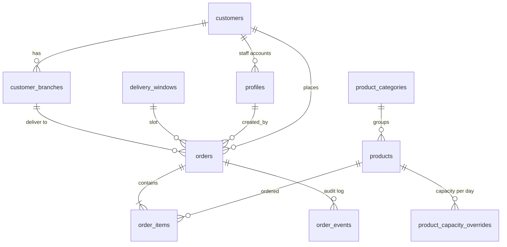
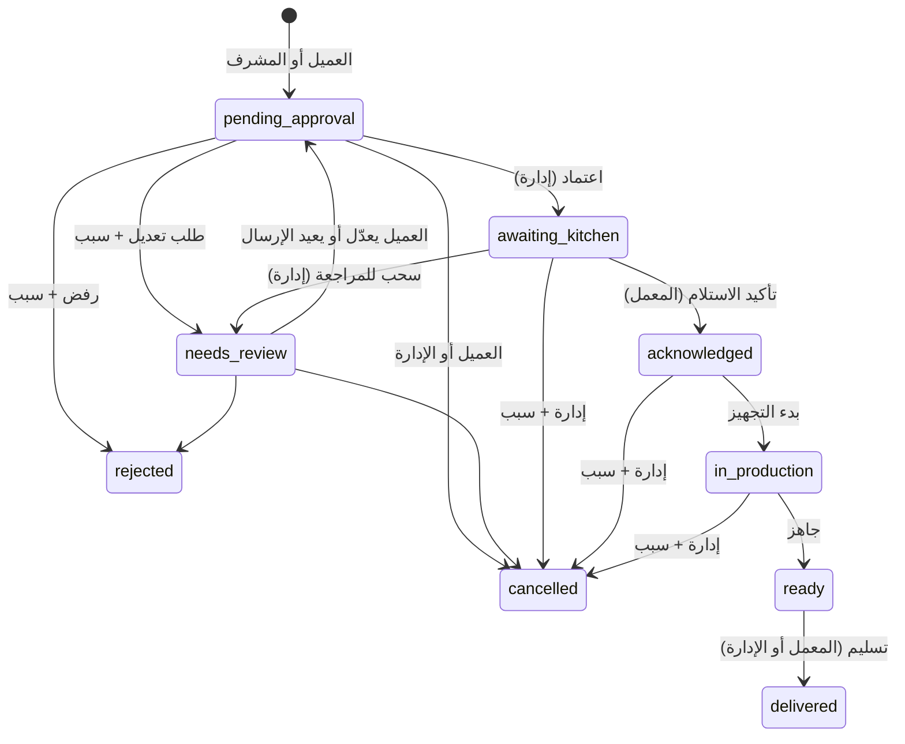

# معمارية Sweet Lab Orders — المرحلة الأولى

## 1. هيكل المشروع

```
sweet-lab-orders/
├── messages/                 ترجمة AR/EN (مفاتيح متطابقة، يفحصها test:i18n)
├── public/icons/             أيقونات PWA
├── scripts/
│   ├── check-i18n.mjs        تطابق الترجمتين + ترجمة كل أخطاء القاعدة ERR_*
│   └── create-super-admin.mjs إنشاء أول مشرف عام (مفتاح الخدمة، من جهازك فقط)
├── supabase/
│   ├── config.toml           التسجيل الذاتي مغلق
│   ├── migrations/
│   │   ├── …0100_core_schema.sql     الجداول والعلاقات
│   │   ├── …0200_auth_and_rls.sql    الأدوار، RLS، إدارة المستخدمين
│   │   └── …0300_order_workflow.sql  دورة الطلب، الجدولة، العروض، Realtime
│   └── tests/database/       اختبارات pgTAP للصلاحيات ودورة الطلب
└── src/
    ├── middleware.ts         اللغة + تحديث الجلسة + منع الدخول بلا حساب
    ├── i18n/                 إعداد next-intl (ar افتراضي RTL، en LTR)
    ├── lib/
    │   ├── supabase/         عميل المتصفح (مفتاح عام فقط) وعميل الخادم
    │   ├── auth.ts           requireProfile / requireRole (حارس خلفي)
    │   ├── nav.ts            قوائم التنقل لكل دور
    │   ├── format.ts         أرقام لاتينية وتوقيت الرياض
    │   └── actions/          Server Actions: الدخول، الخروج، حفظ اللغة
    ├── components/           القالب، التنقل، الحالة، الاتصال، الساعة، Realtime
    └── app/[locale]/
        ├── login/
        └── (app)/
            ├── customer/     بوابة العميل
            ├── admin/        لوحة الإدارة (users للمشرف العام فقط)
            ├── kitchen/      شاشة المعمل (آيباد)
            └── planner/      جدول الإنتاج (إدارة + معمل)
```

## 2. قاعدة البيانات



قرارات مهمة:

- **لقطة المنتج داخل البند** (`product_name_ar/en`, `unit`): تعديل اسم المنتج لاحقاً لا يغيّر الطلبات القديمة. عند إضافة الأسعار يُضاف `unit_price` بنفس الأسلوب.
- **`client_request_id` فريد لكل عميل**: الضغط مرتين أو إعادة الإرسال بعد انقطاع الشبكة يعيد نفس الطلب ولا ينشئ نسخة.
- **`revision`**: يزيد مع كل تعديل. الواجهة ترسل الرقم الذي رأته؛ إن عدّل غيرها الطلب في نفس اللحظة يُرفض التعديل بـ `ERR_STALE_REVISION` بدل أن يمسح تعديلاً آخر.
- **`kitchen_seen_revision`**: إذا عُدّل طلب بعد استلام المعمل له، يصبح `revision > kitchen_seen_revision` فتظهر علامة "تعديل جديد"، ولا يستطيع المعمل تقديم الطلب لمرحلة تالية قبل `acknowledge_order_change`.
- **`order_events`**: كل إنشاء وتعديل وتغيير حالة يُسجل مع المستخدم ودوره والتوقيت والسبب، والتعديلات تحفظ النسخة قبل وبعد.
- **الطاقة الإنتاجية**: `products.daily_capacity` افتراضياً، و`product_capacity_overrides` ليوم محدد. التحقق يتم تحت قفل على مستوى اليوم فلا يتجاوز طلبان متزامنان الطاقة.
- **التوقيت**: كل حسابات "اليوم" و"وقت الإغلاق" عبر `app.riyadh_today()` و`app.riyadh_now()`.

## 3. دورة الطلب



أي انتقال خارج هذا المخطط يُرفض في القاعدة (`ERR_TRANSITION_NOT_ALLOWED`) مهما كانت الواجهة.

## 4. الصلاحيات

| | العميل | المعمل | الإدارة | المشرف العام |
|---|---|---|---|---|
| رؤية الطلبات | طلبات محله فقط | المعتمدة فقط (+ الملغاة بعد الاعتماد) | الكل | الكل |
| إنشاء طلب | لمحله | — | نيابة عن عميل | نيابة عن عميل |
| تعديل طلب | قبل الاعتماد | — | حتى "قيد التجهيز" مع سبب | مثل الإدارة |
| اعتماد/رفض/طلب تعديل | — | — | ✓ | ✓ |
| الاستلام والتجهيز والجاهزية | — | ✓ | — | ✓ |
| التسليم | — | ✓ | ✓ | ✓ |
| المنتجات والعملاء والإعدادات | قراءة الكتالوج | قراءة | ✓ | ✓ |
| الأدوار والحسابات | — | — | حسابات العملاء فقط | ✓ |

كيف تُفرض:

1. **RLS** على كل الجداول للقراءة. Realtime يطبق نفس السياسات، فلا يصل لعميل حدث عن طلب غيره.
2. **لا كتابة مباشرة** على `orders` و`order_items` و`order_events` (أُلغيت الصلاحية من `authenticated`). كل كتابة عبر دوال `SECURITY DEFINER`: `place_order`، `update_order`، `transition_order`، `acknowledge_order_change`.
3. **الدور يأتي من `app_metadata`** الذي لا يُعدَّل إلا بمفتاح الخدمة، والمستخدم لا يملك صلاحية تعديل عمود `role` (صلاحية التعديل على `full_name` و`preferred_locale` فقط).
4. **حارس خلفي في Next.js**: كل منطقة لها `layout` يستدعي `requireRole`، والـ middleware يمنع أي صفحة بدون جلسة.
5. **التسجيل الذاتي مغلق**؛ أي حساب بلا صلاحية صريحة يُنشأ غير مفعّل.

## 5. مسارات المستخدم

- **العميل**: دخول ← الرئيسية (أعداد طلباته حسب الحالة، تتحدث فوراً) ← طلب جديد / طلباتي.
- **الإدارة**: دخول ← لوحة الإدارة (بانتظار الاعتماد أولاً) ← الطلبات / جدول الإنتاج / المنتجات / العملاء / الإعدادات (+ المستخدمون للمشرف العام).
- **المعمل (آيباد)**: دخول ← لوحة المعمل بشريط علوي كبير وساعة بتوقيت الرياض ← جدول الإنتاج.
- اللغة: زر واحد في كل الشاشات، يحفظ الاختيار في ملف المستخدم، ويُفتح الحساب بلغته في الدخول التالي.

## 6. قابلية التوسع

- **الأسعار والفواتير**: `unit_price` في `order_items`، جدول `invoices` مرتبط بـ `orders`، ودالة تحسب الإجمالي داخل `place_order`.
- **المخزون**: جدول `ingredients` و`recipes (product_id, ingredient_id, qty)`؛ جدول الإنتاج يحسب الاحتياج من `production_plan`.
- **واتساب**: Trigger على `order_events` يضيف صفاً في جدول `notifications_outbox`، وEdge Function ترسل وتسجل النتيجة (لا إرسال من المتصفح).
